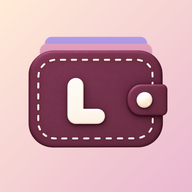

<div align="center">



# Ledgii (Material 3 Expressive Expense Tracker)

[](https://www.android.com/)
[](https://github.com/smartworldarafath/Ledgii/releases)
[](#)
[](#)
[](LICENSE)

**Offline-first personal finance and expense tracking ledger with native 120Hz high refresh rate support and complete privacy telemetry elimination.**

</div>

---

## 📖 Overview

**Ledgii** is a modern, privacy-focused expense tracking and personal budget management application built with **Jetpack Compose** and **Kotlin**. It enables frictionless expense logging, multi-currency support, home screen quick-action widgets, on-device AI voice processing, and intelligent notification-based purchase detection.

This repository hosts the enhanced, hardened source tree of Ledgii featuring **unlocked 120Hz refresh rates** for VRR displays, **zero unconsented background analytics or telemetry**, and universal APK deployment.

---

## ✨ Enhancements in v1.0.0

### 🚀 Native 120Hz Fluid Refresh Rate
- **Dynamic Hardware Display Mode Resolution:** Dynamically detects display modes with the highest refresh rate supported by the device (`Display.getSupportedModes()`) and locks `preferredDisplayModeId` and `preferredRefreshRate = 120.0f` in the WindowManager parameters.
- **VRR & LTPO Optimization:** Ensures buttery smooth 120Hz rendering on Samsung, Xiaomi, OnePlus, Google Pixel, and other high refresh rate devices.
- **Lifecycle-Locked:** Maintains 120Hz consistently across `onCreate()` and `onResume()` lifecycles without dropping back to 60Hz after returning from background.
- **Hardware Acceleration:** Fully hardware-accelerated rendering pipeline with expanded `2.4` aspect ratio support.

### 🛡️ Complete Privacy & Telemetry Hardening
- **Neutralized Google Play Client Telemetry:** Completely disabled `zao.smali` (`log(TelemetryData)` returns an immediate no-op `Tasks.forResult(null)`).
- **Deactivated Google DataTransport / Firelog:**
  - `TransportRuntime.send()`: Neutered to immediately return a clean callback without logging to SQLite or queuing background upload jobs.
  - `CctTransportBackend.send()`: Neutered to return `BackendResponse.ok(-1)` without opening any outbound HTTP/HTTPS connections.
- **Removed Background Schedulers & Receivers:**
  - Excised `JobInfoSchedulerService` and `AlarmManagerSchedulerBroadcastReceiver` from `AndroidManifest.xml` to prevent the OS from ever waking up background telemetry jobs.
  - Removed `ProfileInstaller` telemetry initializers and receivers.
- **Strictly User-Controlled Data:** All transactions, voice logs, and notification purchase detection run entirely on-device. Supabase cloud sync is strictly opt-in and triggered manually by the user.

---

## 📱 Core Features

- **⚡ Frictionless Expense Tracking:** Quick logging of income and expenses with customizable categories, payment methods, and notes.
- **🎙️ On-Device AI Voice Logging:** Log expenses hands-free using natural speech recognition and on-device NLP transaction parsing.
- **🔔 Smart Purchase Detection:** Automatically extracts expense details from incoming transaction SMS/notifications without uploading any personal data.
- **📊 Interactive Visual Analytics:** Comprehensive spending breakdowns, category distributions, monthly comparisons, and budget progress charts.
- **💱 Multi-Currency Architecture:** Supports global fiat and custom currency symbols with configurable formatting.
- **📲 Homescreen Widgets:** Quick glance balance widgets, rapid transaction capture, and dedicated voice logging widgets.
- **🎨 Material You Dynamic Theming:** Fluid dark and light modes adapting to system accent colors with clean typography.

---

## 🛠 Project Structure

```
├── AndroidManifest.xml       # Sanitized application manifest (telemetry services stripped)
├── apktool.yml               # Build configuration, SDK levels, and resource configs
├── app_icon.png              # High-resolution application icon
├── assets/                   # On-device models, fonts, and static resources
├── lib/                      # Pre-compiled native libraries (arm64-v8a, armeabi-v7a, x86, x86_64)
├── original/                 # Original APK metadata
├── res/                      # Android resources, layouts, mipmaps, and vectors
├── smali/                    # Core application bytecode and Jetpack Compose runtime
├── smali_classes2/           # Custom 120Hz helper & hardened transport layers
│   └── com/derek/arrudaledger/
│       ├── HighRefreshRateHelper.smali   # Dynamic 120Hz display mode engine
│       └── MainActivity.smali            # Modified activity lifecycle
└── smali_classes3/           # Extended Kotlin coroutines and support libraries
```

---

## 🔨 How to Build from Source

### Prerequisites
- **Java Development Kit (JDK):** Version 17 or higher
- **Apktool:** Version 3.0.0 or higher
- **Android SDK Build Tools:** 34.0.0+ (`zipalign` and `apksigner`)

### 1. Build the APK
```bash
apktool b . -o dist/Ledgii_unaligned.apk
```

### 2. Align the APK (4-byte page alignment)
```bash
zipalign -p -f 4 dist/Ledgii_unaligned.apk dist/Ledgii_aligned.apk
```

### 3. Sign the APK
```bash
apksigner sign --ks release.keystore --ks-pass pass:YOUR_PASSWORD --key-pass pass:YOUR_PASSWORD dist/Ledgii_aligned.apk
```

---

## 📥 Download

Pre-built, signed, and ready-to-install standalone APK packages are available in the [Releases](https://github.com/smartworldarafath/Ledgii/releases) section.

---

## ⚖️ License

Distributed under the GNU General Public License v3.0 (GPL-3.0). See [LICENSE](LICENSE) for more information.
